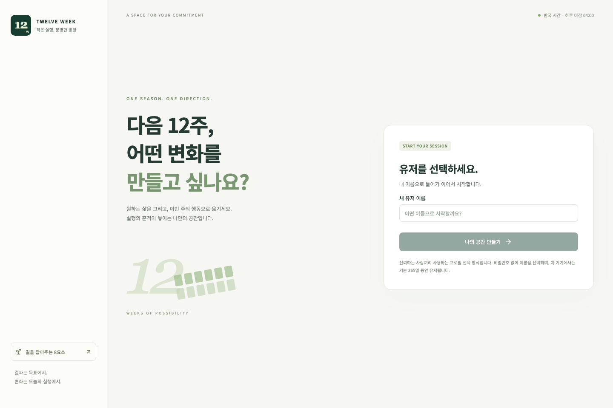

# 구현 상태 · 2026-10-28

2026-10-28 후속 요청으로 사이드바 `계정 설정`에서 비밀번호 재설정과 계정 삭제를 제공한다. 현재 비밀번호로 변경하며 다른 기기 세션을 만료하고, 계정 삭제는 본인 이름·현재 비밀번호·삭제 확인을 요구한다. 삭제는 본인의 주기·실행/평가/독서 기록·AI 대화·연결 정보·세션/OAuth 승인까지 한 트랜잭션으로 처리하며 다른 사용자와 공유 OAuth 클라이언트 등록은 보존한다. 사용자가 잘못 만든 작성 중 주기도 카드 아래 `초안 삭제`에서 제목·기간을 확인하고 삭제할 수 있다. 서버가 소유자·상태·버전을 확인하며 실행 기록이 있는 초안, 실행 중/완료 주기는 삭제를 거부한다.

예시 계정과 미착수 초안 한 개는 사용자 요청으로 운영 DB에서 삭제했다. 전체 백업을 검증하고 다른 계정의 모든 테이블 행 내용 해시와 건수 보존을 확인했다. 사용자가 방금 만든 초안은 대신 삭제하지 않고 삭제 UI를 제공했다. 코드 `bc498ff`의 API·웹 배포와 운영 임시 계정의 비밀번호 변경/세션 만료·초안 삭제·계정 삭제 검증을 완료했으며 임시 계정은 정리했다. [GitHub Checks](https://github.com/joonyy/TwelveWeek/actions/runs/40675843604)에서 단위 58개·PostgreSQL API 56개·Chromium 46개·빌드가 통과했다. 상세 배포 ID·운영 증거는 [DEPLOYMENT.md](DEPLOYMENT.md)를 따른다.

이름 목록을 선택한 뒤 사용자별 비밀번호로 로그인하도록 변경했다. 사이트 공통 접속키는 제거했으며 신규 계정 비밀번호 설정과 로그인 후 비밀번호 변경을 제공한다. 비밀번호는 사용자별 salt를 사용하는 scrypt 해시로 저장하고, 변경 시 현재 기기의 로그인을 보존하면서 다른 기기의 세션을 만료한다. migration `007_profile_password`는 승인된 초기값을 별도로 전달받아 기존 계정에 한 번만 적용한다. 운영 DB 전체 백업을 검증한 뒤 기존 두 계정의 초기화를 완료했고, 이름·ID·목표·실행·평가·변경 이력의 내용 해시가 보존됐음을 확인했다. 단위 58개·API 49개·Chromium 44개와 빌드가 통과했다. **2026-10-28 19:28 KST에 API·프론트 모두 `02f786e` 배포를 완료했다. 실제 운영에서 초기 비밀번호 로그인·잘못된 비밀번호 거부·미인증 주기 접근 차단·기존 10주 주기/2주차 일간 화면의 새로고침 복원·390px 가로 넘침 없음을 확인했다. 배포 후 DB 읽기 전용 확인에서도 기존 9개 테이블 건수가 보존됐다.** 자세한 배포 ID와 증거는 [DEPLOYMENT.md](DEPLOYMENT.md)를 따른다.

2026-10-28 최초 [개인용 Render + Aiven 운영 배포](DEPLOYMENT.md)를 완료했다. 기존 기록을 백업 후 이전하고 관련 테이블의 내용 해시를 대조했다. 당시 공통 개인 접속키를 사용했으며, 현재는 위의 사용자별 비밀번호 방식으로 대체했다. 코드와 환경설정은 기능별 두 커밋으로 push했고 해당 GitHub CI에서 단위 61개·API 44개·Chromium 43개와 빌드가 통과했다. 실제 운영 주소에서도 접근 제한, 임시 초안 저장/재조회, 기존 활성 주기 표시와 390px 화면 복원을 확인했다. 임시 검증 데이터는 정리했으며 기존 목표·전술·완료·평가 내용은 바꾸지 않았다. 운영 기록의 원본은 Aiven이고 로컬 Docker DB와 자동 동기화되지 않는다. GitHub 10분 간격 keepalive를 활성화했고 첫 실행 성공을 확인했다.

독서 실행에 책·단원·한 줄 생각을 저장·수정하는 흐름을 추가했다. 초안 저장은 점수를 바꾸지 않으며, 독서 완료 시 기록을 함께 검증·저장한다. 완료된 기록의 내용 수정은 허용하고 완료 취소 시 기록을 보존하며, 삭제는 미완료 상태에서만 허용한다. 과거 실행·기존 완료를 자동으로 바꾸지 않는다. 책별 모아보기와 Markdown 내보내기로 SecondBrain에서 재사용할 수 있다. 미래 계획 재생성에도 기록을 보존하고 버전·소유자·완료 시각·입력 길이를 서버에서 검사한다.

목표별 계획에 선택형 기획서 URL을 추가하고 실행 계획표의 목표 상세에 링크를 표시한다. http/https 주소만 허용하며 새 창에서 안전하게 연다. 목표 착수에 필수로 요구하지 않고, Notion 페이지 생성·동기화·외부 쓰기는 구현하지 않았다.

사용자 승인으로 실제 로컬 첫 주기(version 71→72)에 블로그 개설·첫 글 공개를 AI 학습 목표의 1주차 1회 전술로 추가했다. 날짜·시간은 미지정이며 디자인·수익화를 완료 조건에 포함하지 않는다. 『세컨드 브레인』 독서 전술의 기록 장소와 책 설정을 원래 계획 및 해당 전술이 있는 1~4주 스냅샷에 반영했다. 기존 실행 25개·완료 7개·회고·주별 횟수를 보존하고 새 미완료 실행 하나만 추가했으며, 5~10주 상태와 다른 목표 내용은 변경하지 않았다. 전술은 11→12개로 늘어 주간 점수는 18.1818→16.6667%로 재계산된다. DB 변경 전 백업과 변경 이력을 남기고 별도 읽기 전용 조회로 보존을 검증했다.

독서 기록·기획서 링크 검증은 단위 55개·PostgreSQL API 44개·Chromium 전체 42개·프론트 빌드·`git diff --check`가 통과했다. 기록 초안/완료의 원자 저장, 완료 후 내용 수정과 점수 보존, 삭제 제한, 저장 실패 입력 유지, 재접속·책별 조회·Markdown 다운로드·390px 화면, http/https 링크 저장과 실행 계획표 연결, 소유 범위·버전·미래 완료 시각·입력 검증을 확인했다. 장시간 지연된 회귀 실행은 성공 근거에서 제외하고, 이후 전체 42개를 새로 실행해 모두 통과했다. 외부 Notion·블로그·Apple Calendar에는 쓰지 않았다.

실행 횟수를 상한이 아닌 최소 약속으로 다룬다. 기존 주별 기준은 유지하고 앞으로 추가하는 실행에 선택 실행 표시를 저장한다. 추가 실행 등록 시 최소 횟수·평가 분모·다른 주와 원래 계획은 변하지 않는다. 추가 실행을 완료하면 해당 전술의 주간 최소 달성에 반영하고 100%를 넘는 부분은 초과 실행 횟수로 따로 표시한다. 미완료 추가 실행은 점수를 낮추지 않는다. 일간 점수는 원래 날짜별 약속만 평가하며 선택 실행은 별도 완료 수로 보여준다. 매일 전술의 날짜별 약속은 다른 날의 초과 실행으로 대체하지 않는다. 미래 계획 재생성 시 선택 실행 ID·일정·완료 증거를 보존하고 기존 주별 횟수는 소급 변경하지 않았다.

모범 주간 단계 위에 전체 기간 마일스톤 로드맵을 추가했다. 작성 중인 목표·전술의 실행 주차를 그대로 사용하며, 연속 기간과 떨어진 기간·최종 적용 주·주차 미정을 구분한다. 주차를 누르면 해당 주의 최소 횟수와 전술을 모아 보고, 목표 계획 수정이나 주차별 상세로 이동한다. 저장 전 수정도 반영하며 별도 마일스톤 입력·목표 자동 수정·저장 요청을 만들지 않는다. 좁은 화면에서는 이름을 고정한 채 기간을 좌우로 스크롤한다. 실제 사용자 DB는 읽기 전용으로 검토했으며 기존 목표·실행 기록·점수를 재작성하거나 커밋·푸시하지 않았다.

최소 약속·로드맵 변경은 단위 53개·PostgreSQL API 40개·Chromium 전체 40개·프론트 빌드·`git diff --check`가 통과했다. 추가 실행의 확인/취소·완료·배치/복사·재접속, 고정된 최소 분모·전술별 100% 제한·다른 전술 비중 보존, 미래 계획 변경 후 추가 기록 보존, 매일 전술 날짜 대체 방지, 전체 기간/띄엄띄엄 지정한 주차·미정 주차·저장 전 편집·390px 화면을 검증했다. DB 테스트는 전용 `_test` DB를 사용했다.

`이번 주 계획표`의 집계를 완료 / 실행 없이 지남 / 예정·미완료 / 아직 시간 미정의 네 상태로 나눴다. 기존 ‘앞으로 할 실행’에 ‘미배치’가 포함돼 합산처럼 보이던 중복 표현을 제거하고, 네 상태의 합이 전체 실행 수와 일치하게 했다. 평가 날짜가 지났는데 완료 기록이 없는 회차는 시간 배치 유무와 관계없이 ‘실행 없이 지남’으로 표시한다. 오늘의 실행은 다음 날 04시까지 열어 두고, 날짜가 없는 실행은 그 주가 끝난 뒤에만 지난 미완료로 분류한다. 지난 실행만 남은 전술도 카드에 유지하며 ‘지난 실행 확인’으로 전체 회차를 펼친다. 상단 집계·카드·전체 회차는 같은 상태 판정을 사용하고 기존 4개 카드 접기를 유지한다. 실제 사용자 데이터·전술 횟수·완료 기록·점수와 API·DB schema는 변경하지 않았다.

상태 구분 후 단위 49개·관련 Chromium 4개·프론트 빌드·`git diff --check`가 통과했다. 배치 해제된 완료/지난 미완료, 날짜 미정, 04시와 주 종료 경계, 집계 합계, 지난 실행 카드·전체 회차 연결, 390px 화면과 기존 실행 배치·접기·복사를 검증했다. 별도 `_test` DB에서 화면 열기·펼치기가 저장 상태·점수·원래 계획을 바꾸지 않으며 변경 요청도 보내지 않음을 확인했다.

`이번 주 계획표` 첫 화면에 이번 주 할 일 목록을 시간표보다 먼저 배치했다. 완료·앞으로 할 실행·시간 미배치 수를 요약하고 전술별 다음 실행의 시간 배치 또는 일정 수정을 바로 열 수 있다. 실제 2주차에는 전술 11개가 있어 처음 4개만 보여주고 나머지 7개를 펼치는 방식으로 압축했다. 긴 1회 완료 기준은 카드에서 개별적으로 펼치며, 전술별 전체 회차와 완료 기준은 시간표 아래에서 펼쳐 본다. 계획표에 있던 큰 점수 카드도 이 탭에서는 숨겨 첫 실행 목록에 먼저 도달하게 했다. 표시 구조만 변경했으며 실제 사용자 기록·실행 횟수·점수는 바꾸지 않았다.

`이번 주 계획표`의 주간 캘린더만 640px 내부 높이 제한을 해제해 04:00~다음 날 04:00을 페이지에서 모두 볼 수 있게 했다. 내부 세로 스크롤은 없고, 좁은 화면의 요일별 가로 스크롤은 유지한다. 전체 높이에서 블록을 끌 때는 페이지가 자동 스크롤되도록 보완했다. 브라우저 관련 4개 테스트와 프론트 빌드가 통과했다. 캘린더가 길어져 전술 목록이 멀어지는 문제는 위의 실행 목록을 시간표 위에 배치해 대응했다.

2026-10-23 `이번 주 계획표`에서 시간표 편집을 기본으로 열어, 별도 조정 화면으로 이동하지 않고 근무·전략·버퍼·브레이크아웃·전술 실행을 한 캘린더에서 선택·배치한다. 일반 블록은 기존처럼 `이번 주 시간표 저장`으로 반영하고 전술 실행은 배치 시 바로 저장한다. 선택한 블록은 ⌘C/Ctrl+C로 복사하고, 빈 시간을 고른 뒤 ⌘V/Ctrl+V 또는 붙여넣기 버튼으로 복제한다. 일반 블록 복제는 초안에만 반영되며, 전술 실행 복제는 기존 회차 이동이 아닌 해당 주의 새 회차와 점수 기준 증가를 확인받는다. 매일 전술은 복제하지 않는다. 지난주·완료 주기는 읽기 전용이다. 실제 사용자 기록은 변경하지 않았다.

관련 변경 후 단위 46개·Chromium 전체 36개·프론트 빌드가 통과했다. 복사 취소 시 회차 불변, 전술 복사 승인 시 해당 주만 증가, 매일 전술 복제 차단, 일반 블록 저장 전 초안/저장·새로고침 후 복원, 계획표의 모바일 너비와 기존 캘린더·일간 흐름을 확인했다. 테스트는 별도 `_test` DB를 사용했고 실제 Apple Calendar나 운영 DB에는 쓰지 않았다.

2026-10-22 일간 원형 실행 블록의 양끝 길이 조절을 추가했다. 블록을 선택하면 위·아래 화살표 손잡이가 나타나고, 시작 손잡이는 종료 시각을 고정한 채 시작 시각을, 종료 손잡이는 시작 시각을 고정한 채 종료 시각을 바꾼다. 마우스·터치 드래그와 방향키로 30분씩 조절하며 주간 캘린더와 같은 5~720분 및 평가일/주간 경계 규칙을 사용한다. 04시를 넘는 블록은 각 날짜에 실제로 존재하는 시작/끝 손잡이만 표시한다. 드래그 중 시각·길이를 미리 보여주고 놓을 때 기존 일정 API로 저장한다. Esc 취소·저장 실패·⌘Z/Ctrl+Z·다시 실행은 기존 배치와 공유하고, 손잡이 저장 후에도 키보드 포커스를 유지한다. 시간표 루트에서 터치 스크롤과 조절이 충돌하지 않도록 처리했다. 전술 횟수·평가 날짜·실행 점수·다른 주·기존 완료 기록과 실제 사용자 데이터는 변경하지 않았다.

길이 조절은 단위 46개·관련 Chromium 10개·프론트 빌드·`git diff --check`를 통과했다. 양끝 각각의 증가/감소, 반대쪽 시각 고정, 방향키·되돌리기, Esc 취소/저장 실패 시 복원, 완료 항목 보호, DB 저장/재접속과 주간 화면 공유를 확인했다. 모바일 터치로 매일 전술의 날짜를 유지하고 04시 이후 이어지는 조각의 종료 시각만 조절하는 흐름 및 390px 화면도 검증했다. API·DB schema는 이번 변경으로 바꾸지 않았다.

2026-10-22 일간 원형 시간표를 캘린더 방식으로 편집한다. 실행 블록은 한 번 클릭해 선택하고 더블클릭/Enter로 상세 편집하며, 원을 따라 30분 단위로 끌어 시간대를 이동한다. Backspace/Delete와 ‘시간 배치 해제’는 시간 블록만 없애고 해당 평가 날짜의 약속·일간 분모·주간 전술/횟수·완료/회고를 유지한다. 해제 상태는 `timePlaced: false`로 주간 JSON에 저장하며 일간 목록에 ‘시간 미배치’로 표시하고 주간 미배치 목록에서도 재배치할 수 있다. 원형표·주간 캘린더·계획표·내보내기가 같은 배치 상태를 사용하고 미래 계획 재저장에도 유지된다. ⌘Z/Ctrl+Z와 다시 실행은 동일 일정 API를 사용해 저장된 변경을 복원한다. 기록은 주별 최근 50건이며 주차 전환/새로고침에는 초기화한다. 완료 기록·지나간 주 배치 해제·소유 범위·버전 충돌은 서버에서 보호하고 실패한 저장은 되돌리기 이력에 추가하지 않는다. 실제 사용자 데이터는 임의로 수정하지 않았다.

일간 편집 변경 후 단위 46개·PostgreSQL API 40개·Chromium 전체 31개를 통과했다. 완료된 시간 미배치 항목을 재배치 목록에서 제외하는 후속 보완과 새 시나리오를 포함해 관련 Chromium 7개도 통과했다. 삭제/복원/다시 실행/상세 편집/드래그 이동, Esc 취소·저장 실패 시 원래 배치 유지, 점수/다른 주 보존, 주간 화면과 재배치 공유, 주차 전환 시 이력 분리와 390px 화면을 확인했다. 프론트 빌드와 실제 웹/API HTTP 200도 확인했다.

최종 일간 편집·완료 기록 보호 2개 시나리오는 각각 2회 반복해 4개 모두 통과했다. 테스트의 기준 상태 조회와 다음 단축키는 저장 완료를 확인한 뒤 수행하도록 정리하고 반복 실행의 프로필 이름을 분리했다.

2026-10-22 기존 전술의 실행 횟수를 선택한 주에만 n→n+1로 늘릴 수 있다. 일간·주간 실행 배치창에서는 기존 회차 이동과 ‘이번 주 1회 더 추가’를 구분하고, 주차별 시간표 조정에서도 실행 회차에서 추가를 선택한다. 확인창은 횟수와 평가 기준이 함께 늘고 새 회차가 미완료로 시작함을 알리며, 미배치 기존 회차가 있으면 함께 안내한다. 선택한 주의 전술 수·동일 비중·기존 실행·회고·다른 주·원래 계획은 보존한다. 주별 횟수는 주간 상태에 저장하고 미래 주의 계획/시간표 재저장에도 유지한다. 과거 날짜/지난주·매일 전술의 날짜 대체·버전 충돌·소유 범위·전술당 50회/주당 600회 제한은 서버에서도 검사하며 변경 이력을 남긴다. 실제 사용자 전술 횟수는 임의로 바꾸지 않았다.

횟수 추가 후 단위 44개·PostgreSQL API 38개·Chromium 전체 29개·프론트 빌드를 통과했다. 추가 승인/취소, 일간·주간 조정의 공통 저장, 원래 계획·다른 주·완료·회고 보존, 동일 전술 비중과 분모 증가, 미래 주 재저장 시 횟수 유지, 날짜·소유·버전·횟수 제한을 별도 `_test` DB로 검증했다. 실제 로컬 웹 5178의 HTTP 200도 확인했다.

2026-10-22 새로고침 시 현재 화면을 복원한다. 주소의 hash에 주기·화면·계획 탭/보기 방식/선택 목표/계획 주차·실행 주차/탭/평가 날짜를 기록하며, 로그인 확인과 소유 주기 조회 후 해당 화면을 연다. 기간 밖 주차·날짜와 없는 목표는 현재 유효 범위로 보정하고, 없는/접근 불가 주기는 목록으로 돌아간다. 통신 실패는 복원 오류를 표시하고 주소를 유지해 재시도할 수 있다. 목록으로 직접 이동하거나 로그아웃하면 위치를 지우며 늦게 도착한 주기 열기 응답이 이전 화면을 다시 열지 않도록 보호한다. 주소에는 이동 정보만 저장하고 인증 토큰·폼 내용은 넣지 않는다. 미저장 계획/회고/시간표의 기존 이탈 경고와 명시적 저장 절차는 유지한다. DB schema/API/실행 점수와 실제 사용자 기록은 변경하지 않았다.

화면 복원 후 Chromium 전체 28개·프론트 빌드·`git diff --check`를 통과했다. 신규 흐름은 실행 4개 탭·주차·날짜·계획 탭·선택 목표·주차별 보기를 새로고침으로 직접 검증하고, 복원 과정에서 데이터 변경 요청이 발생하지 않음을 확인한다. 잘못된 주소·지난 기간의 주차 보정·조회 불가 주기·연결 실패 후 재시도·목록 이동·로그아웃도 검증했다. 기존 DB 저장 검증은 서버 응답 완료 뒤 확인하도록 정리했으며, 이전처럼 새로고침 후 주기를 다시 선택하던 테스트는 복원된 화면에서 이어가도록 갱신했다.

2026-10-22 블록 종류 선택을 시간표 위의 색상별 버튼으로 바꿨다. 근무·고정 일정/전략/버퍼/브레이크아웃/전술 실행 중 종류를 먼저 고르면 빈 시간 클릭·드래그·추가 버튼이 해당 종류로 새 블록을 연다. 상세 편집창의 종류 선택도 전술 입력보다 위에 배치했다. 기존 근무·생활 블록의 종류·시간 수정과 실행 취소를 유지하며, 근무는 회색·전략은 연두색·버퍼는 청색·브레이크아웃은 노란색으로 표시·저장·복원한다. 관련 Chromium 5개·프론트 빌드·`git diff --check`를 통과했다. 종류별 생성/변경/색상 차이/저장 후 복원, 점수·다른 주 기록 보존, 기존 전술 배치·드래그·단축키와 390px 버튼 줄바꿈을 검증했다. 실제 사용자 기록은 수정하지 않았다. [블록 종류 선택 화면](screenshots/calendar-block-types.png).

2026-10-22 시간표 편집 조작을 개선했다. 기본 모범 주간과 주차별 시간표 조정에서 블록 한 번 클릭은 선택, 더블클릭/Enter는 상세 편집으로 동작한다. 선택한 근무·생활 블록은 Backspace/Delete로 삭제하며, 편집 중 추가·수정·이동·길이 조절·삭제를 ⌘Z/Ctrl+Z로 되돌리고 ⇧⌘Z/Ctrl+Shift+Z로 다시 실행한다. 선택 표시와 상세 편집·삭제·실행 취소 버튼을 함께 제공한다. 입력칸·상세 편집창은 글 편집 단축키를 유지하며, 저장/취소로 조정 화면을 닫거나 다른 주·별도 설정 초기화로 전환하면 편집 이력도 초기화한다. 실제 전술 실행은 기존 평가 약속을 보존하므로 이 삭제/되돌리기 대상에 포함하지 않고 기존 일정 변경 경로를 유지한다. DB schema/API/실행 점수는 변경하지 않았다.

이번 변경은 Chromium 전체 25개·프론트 빌드·`git diff --check`를 통과했다. 신규 흐름에서 선택·삭제·실행 취소/다시 실행·추가/편집/이동/길이 조절 복원·입력칸 보호·실제 전술 실행 삭제 방지·주차별 저장/재접속과 초기화 후 이력 분리·390px 가로 넘침 없음을 확인했다. 별도 `_test` DB를 사용했으며 실제 사용자의 시간표·목표·전술·실행 기록은 변경하지 않았다.

최초에는 첫 사용자용 웹 흐름을 로컬에서 구현·검증했다. GitHub 원격은 [joonyy/TwelveWeek](https://github.com/joonyy/TwelveWeek)이며 기본 브랜치는 `main`이다. 당시 미실행이었던 Aiven/Render 자원 생성과 운영 배포는 위의 2026-10-28 기록처럼 완료했다.

## 사용할 수 있는 흐름

- 이름 생성/선택, 긴 세션 유지와 유저 전환.
- 비전, 목표별 12주 계획·장애물/대응·지표, 모범 주간, 공통 삶의 태도 1~11 영역 저장.
- 계획 화면의 목표별/주차별 보기 전환. 착수 전에도 주차별 전술·횟수·완료 기준과 전체 실행 횟수 확인. 저장 전 수정 반영, 기존 목표 편집으로 이동, 주차 미지정 전술 표시.
- 8요소 전체 도움말과 작성/실행/평가 순간별 안내.
- 12주 착수, 주간 전술 기준 보존, 미래 주의 계획 조정.
- 같은 주 일정 배치/변경, 매일 전술 날짜 유지, 04:00 경계의 일간 체크와 지난 실행 시각 정정.
- 일간 점수, 전술별 동일 비중의 주간 점수, 선행/후행지표와 선택형 주간 평가 저장.
- 모범 주간을 함께 보는 주간 일정, Apple Calendar용 .ics 다운로드.
- 미배치 실행을 주간 캘린더로 드래그해 배치, 배치된 일정 이동·위/아래 가장자리 시간 조절(30분 단위, 마우스·터치·방향키), 미리보기·Esc 취소.
- 일간 24시간 원형표에서 모범 주간과 실제 실행 비교, 클릭/드래그 범위 배치·일정 수정. 일간·주간은 같은 실행 ID와 저장 API를 사용하고, 미래 주의 주간 반복 실행만 배치를 해제할 수 있다.
- 원형표의 활동별 색상과 색상 안내, 일간·주간에서 주차별 근무·생활 시간표 조정. 해당 주만 저장하거나 기본 모범 주간에도 반영하고, 별도 설정을 해제할 수 있다. 이미 시작한 다른 주·별도 설정과 실행 기록/점수를 보존한다.
- 주차별 시간표의 신규 블록에서 전술과 실행 회차를 골라 실제 일정에 바로 배치. 기존 회차 이동·매일 평가일 준수·완료 실행 보호와 일반 시간 블록의 별도 저장을 지원한다. 별도 `이번 주 계획표` 탭에서 해당 주에 적용되는 목표·전술·완료 기준·횟수·배치 상태 확인과 일정 수정이 가능하다.
- 원형표의 모범 주간 블록 호버/키보드 포커스 상세 안내, 한국 시간 실시간 시계와 해당 평가일의 현재 시간 표시. 집중 25분/짧은 휴식 5분/긴 휴식 10분 선택, 시작·일시정지·초기화. 각 구간이 끝나면 알람을 울리고 완료 상태로 대기하며 다음 구간은 직접 시작한다. 타이머는 주기별 브라우저 저장소를 사용해 화면 전환·새로고침 뒤에도 남은 시간을 복원하며 실행 점수에 포함하지 않는다.
- 주차별 화면의 iCloud 연결·기존 일정 불러오기·클릭/드래그 배치·겹침 검토·새 일정 생성 또는 기존 일정 연결. 실제 계정 연결 전에는 테스트 제공자로 검증했다.
- 13주차 12주 점수 추이, 선택형 회고, 주기 마무리와 기록 보관.
- 데스크톱/모바일 화면, 저장 전 이탈 안내, 요청 실패/충돌 표시, 변경 감사 기록.
- 실행 기간 1~12주 선택. 11주 목표·전술 주차·종료일·회고 주간 표시, 해당 기간만 집계. 기존 주기는 기본 12주로 보존하며 DB migration `003_cycle_length`를 자동 적용한다.
- 초안의 기간 변경, 착수 후 미래 주만 축소. 제외되는 미래 주 DB 기록·변경 이력을 보존하며 이번 주와 지난주의 실행 기준·점수는 유지한다.
- 장기비전 AI 대화 저장·재개, 선택한 ChatGPT/Claude 대화 가져오기, API 키 연결, 주기별 수정 권한·전후 이력·되돌리기. 미저장 편집과 외부 AI 변경 충돌을 보호한다.
- ChatGPT·Claude 등 외부 AI용 MCP 읽기/수정 도구와 OAuth 연결 승인·철회. 선택형 로컬 Codex thread resume. [연결 안내와 실제 확인 범위](AI_INTEGRATION.md).
- AI 대화·비전 수정안·수정 이력의 Markdown 표시. 제목·강조·목록·인용·링크·코드·GFM 표/체크리스트/취소선, 모바일에서 표·긴 코드의 내부 가로 스크롤. 저장 원문 보존 및 HTML/위험 링크 실행 차단.
- Codex 앱의 managed daemon에 직접 연결, 응답 중인 같은 대화 보호, 연결 오류의 요청 단위 처리·재연결, 저장된 질문의 중복 없는 재시도. 로컬 서버를 실행 세션에서 분리하는 `dev:background`와 지속 로그.
- macOS 바탕화면 `TwelveWeek.command` 실행파일. Docker·기존 DB·API·웹 준비 후 앱을 열고 같은 터미널에서 로그를 보여준다. 반복 실행 시 서버를 중복으로 시작하지 않으며, 터미널 종료와 서버 실행을 분리한다.

## 입력 화면 개선 · 사용자 후속 요청 반영

- 플로팅 저장: 계획 작성의 모든 탭에서 오른쪽 아래 원형 저장 아이콘을 고정 표시한다. 기존 저장 함수를 재사용하며 미저장 변경, 저장 중, 저장 완료 상태를 표시하고 중복 클릭을 막는다. 보관된 주기에는 표시하지 않으며 모바일 안전 영역·하단 메뉴·저장 알림과의 간격을 확보했다.
- 장기 비전과 3년 비전: 목록/자유 서술 선택, 목록 기본, 항목 추가·삭제·Enter 입력. 내용·입력 방식 저장 및 복원.
- 새 계획: 목표 3개와 목표별 전술·장애물 칸을 준비. 빈 기본 목표는 착수·주간 분모에서 제외하며 일부 작성한 목표의 필수 항목은 검사.
- 목표 먼저 나열하기: 목표 목록과 목표별 계획을 별도 화면으로 분리. 목록에서 제목 전체를 먼저 보고, 다음 화면에서 목표를 선택해 성공 기준·기대 변화·전술·장애물·지표를 작성한다. 목록 수정·목표 전환·저장·새로고침 후 목표/전술 ID와 기존 내용 유지, 이름이 없는 기존 계획 접근, 모바일 가로 넘침 없음을 확인했다.
- 3년 비전 연결: 목표 목록 옆에 개인 생활·커리어 비전을 보여주고, 목표마다 관련 항목을 복수 선택·해제한다. 다음 계획 화면에도 연결 문구를 표시한다. 비전 항목 ID와 연결을 DB에 저장하며 문구 수정·목록 삽입·삭제·자유 서술 순서 변경에도 연결을 보존한다. 삭제되거나 대응이 불명확해진 항목은 `연결 검토`로 남긴다. 기존 목표·전술·주간 점수 기준은 유지한다.
- 정리노트 기반 작성 안내: 사진 11장과 템플릿 초안을 재대조해 1~11 영역마다 질문·작성 포인트·유의할 점을 기본으로 펼쳐 표시한다. 장기 비전의 상상과 나열, 목표의 다섯 조건, 전술의 우선순위·완료 조건·실행 주차, 장애물과 대응, 행동/결과 지표, 시간 블록과 삶의 태도를 구체적으로 안내한다. 각 입력란의 설명과 캘린더 블록별 역할도 함께 표시한다. 일간·주간·주기 회고는 정리노트와 사용자 추가 운영 규칙을 구분해 안내한다.
- 모범 주간: 실제 주간 캘린더 UI, 빈 시간대 클릭 또는 위아래 드래그 생성. 드래그 중 30분 단위 시간 범위 미리보기, 놓으면 해당 길이로 입력창 열기, Esc 취소와 화면 끝 자동 스크롤. 시간 블록 수정·삭제·30분 단위 드래그 이동. 04:00를 넘기는 블록과 겹친 블록 표시. 실제 일정도 같은 캘린더로 표현.
- 책임: IMG_0076의 네 가지 태도 및 개인 생활·일에서 실천할 목록. 기존 책임 메모 유지.
- 헌신: IMG_0077의 7영역 바퀴, 영역별 목표 선언·핵심 활동·헌신 비용과 선택한 활동의 동그라미. 사용자 지정 기존 영역 유지.
- 단위·DB·브라우저에서 기존 자료 보존, 세 가지 빈 목표 제외, 목록 전환, 캘린더 드래그, 헌신 선택·새로고침 복원을 확인. 모바일 가로 넘침 없음.
- 브라우저 테스트는 별도 4111/5179 포트를 사용하여 실제 로컬 앱을 계속 열어둘 수 있음.

[비전 목록](screenshots/vision-lists.png) · [모범 주간](screenshots/model-calendar.png) · [책임](screenshots/responsibility.png) · [헌신 바퀴](screenshots/commitment-wheel.png)

[목표 목록](screenshots/goal-list.png) · [목표별 계획](screenshots/goal-plan.png) · [모바일 목표 목록](screenshots/goal-list-mobile.png)

[3년 비전과 목표 연결](screenshots/vision-goals-desktop.png) · [모바일 비전 연결](screenshots/vision-goals-mobile.png)

[노트 기반 목표 작성 안내](screenshots/guided-goals.png) · [계획 작성 안내](screenshots/guided-plan.png) · [모바일 작성 안내](screenshots/guided-writing-mobile.png)

## 검증 결과

| 검증                         | 결과                                                                                                                                                                                                                                                                                                                              |
| ---------------------------- | --------------------------------------------------------------------------------------------------------------------------------------------------------------------------------------------------------------------------------------------------------------------------------------------------------------------------------- |
| 도메인·입력 구조 단위 테스트 | 29/29 통과(10/15 재검증). 비전 항목 연결의 ID 보존·삭제 참조 검토·기존 계획 호환·점수 불변과 기존 기간·점수·캘린더 보존, 대화 import, 암호화, 제공자 요청 schema, Codex RPC 재개·읽기 전용 범위·파이프 오류/재연결·Unix WebSocket daemon 공유·동시 응답 보호·해당 turn만 중단                                                     |
| 실제 PostgreSQL API 통합     | 24/24 통과(10/8). 비전 항목/목표 연결의 DB 저장·복원·소유 범위·고정 실행 기준 보존과 기존 계획·점수·기간 보존, 대화 복원, 비전 변경·되돌리기·권한 철회 중 응답, 실제 MCP SDK handshake/읽기/쓰기, OAuth S256 PKCE·단회 코드·refresh 회전·연결 철회, AI 실패 후 서버 정상 응답·질문 보존·중복 없는 재시도                          |
| Chromium 전체 사용자 흐름    | 13개 통과(10/15).작성 1~11·일간/주간/회고 안내의 기본 노출·10주 표기·입력 후 유지·설명 연결·모바일 5개 탭·저장 전후 내용/ID 보존을 확인. 기존 비전 연결·목표 전환·착수·일정·실행·평가·기간·AI 대화와 수정·Markdown·오류 재시도 전체 흐름도 통과. 모바일 390px 가로 넘침 없음. 10/7 AI 흐름 3개×3회 추가 검증은 과거 기록으로 보존 |
| 프로덕션 프론트 빌드         | 성공                                                                                                                                                                                                                                                                                                                              |
| Docker Node 22               | 10/7 단위 21/21 및 PostgreSQL/MCP API 23/23 통과. 10/8 비전 연결 변경의 로컬 검증은 Node 24.7.0이며 Node 22 재검증은 미실행                                                                                                                                                                                                       |
| 배포/CI 설정                 | Render, Compose, GitHub workflow YAML 파싱 성공. 실제 클라우드 적용은 미실행                                                                                                                                                                                                                                                      |
| keepalive                    | 로컬 API health와 프론트 요청 성공. 원격 cron 활성화는 미실행                                                                                                                                                                                                                                                                     |
| macOS 실행파일               | 저장소/바탕화면 실행파일의 zsh 문법·실행 권한 확인. 실제 실행파일을 `--no-open`으로 2회 실행해 기존 DB 정상 상태, 서버 중복 시작 방지, API·웹 정상 응답 확인. 브라우저 자동 열기와 실시간 로그는 기본 실행에 포함                                                                                                                 |
| 패키지 설치 감사             | 설치 시 취약점 0건 보고. package.json/lockfile 일치 확인                                                                                                                                                                                                                                                                          |
| 실제 사용 DB                 | 별도 `twelve_week`. 테스트 DB `twelve_week_test`와 분리. 실제 사용자 기록은 테스트 초기화 대상에서 제외하며 기존 초안 내용·시작일·기간을 임의로 변경하지 않음                                                                                                                                                                     |

10/8 목표/계획 화면 분리 이후 3년 비전 연결을 추가했다. 계획 입력 schema와 선택형 연결 저장 구조를 확장했으며 SQL schema·실행 점수 계산은 변경하지 않았다. 단위 29개·API 24개·브라우저 12개·프론트 빌드를 다시 검증했다. 실제 사용자 기록은 수정하지 않았다.

10/15 작성 안내 개선은 UI와 문구 변경이다. 단위 29개·Chromium 13개·프론트 빌드를 재검증했다. API·DB schema·점수 계산은 변경하지 않았고 API 24개 검증은 10/8 결과다. 자동 검증은 별도 `_test` DB를 사용한다. 누락된 Playwright headless Chromium 실행파일을 복구했으며, 기본 실행 주차에 의존하는 기존 테스트의 브라우저 날짜를 테스트 서버와 맞춰 날짜 경과로 인한 실패를 수정했다.

10/16 플로팅 저장 버튼 추가 후 프론트 빌드와 기존 목표/계획·작성 안내 브라우저 테스트 2개가 통과했다. 별도 테스트 DB의 브라우저에서 페이지 하단 저장과 새로고침 후 복원, 데스크톱 56px 원형 버튼의 우측·하단 24px 고정, 모바일 390px에서 16px 고정·가로 넘침 없음·하단 메뉴/저장 알림과 겹침 없음을 확인했다. 실제 사용자 기록은 검증용으로 수정하지 않았다.

테스트 API 서버의 시각은 2026-10-07로 고정했고 기본 실행 주차에 의존하는 브라우저 흐름도 같은 날짜를 사용한다. 실제 앱·API는 현재 시각으로 동작한다. 테스트 성공은 실제 한 주의 사용이나 Apple Calendar 앱의 가져오기 성공을 의미하지 않는다.

자동화 검사의 AI 출력은 모의 응답을 사용한다. 실제 로컬 Codex 목록과 저장 thread 이력 조회, managed daemon의 연결을 확인했다. 10월 7일 임시 thread에서 실제 Codex 모델 응답도 확인했으며, 사용자 앱 대화·비전은 변경하지 않았다. 실패했던 사용자의 입력은 DB에 보존되어 있고 재시도할 수 있다. OpenAI/Claude 실제 API 키는 아직 연결되지 않았으며 해당 제공자의 유료 요청과 ChatGPT/Claude 원격 OAuth UI 연결은 미검증이다.

[장기비전 AI 데스크톱](screenshots/vision-ai-desktop.png) · [모바일](screenshots/vision-ai-mobile.png)

2026-10-21 주차별 계획 미리보기는 기존 계획을 읽는 UI 변경이다. 도메인·단위 29개, 주차별 미리보기·목표별 편집·캘린더/헌신 편집 브라우저 흐름 3개와 프론트 빌드를 확인했다. 주간 반복/매일/선택 주차 1회의 집계, 8주차에만 배치한 전술, 빈 주차, 기간 축소, 저장 전 수정과 저장·새로고침 후 ID 보존, 모바일 가로 스크롤을 검증했다. 실제 사용자 목표·전술·실행 상태는 변경하지 않았다. 캘린더 병합·충돌 처리와 원격 배포는 이 검증에 포함하지 않는다.

2026-10-21 iCloud 비교·선택 반영을 추가했다. 단위 36개·전체 PostgreSQL/API 29개를 통과했고, 기존 브라우저 14개와 신규 캘린더 병합 1개 흐름을 검증했다. 신규 흐름의 테스트 진입 경로를 마지막 ‘삶의 태도 → 착수’ 순서로 수정한 뒤 재실행해 통과했다. 데스크톱/390px 모바일에서 기존 일정 연결·겹침 검토·최종 적용과 초안 배치의 착수 후 보존을 확인했다. 새 제공자는 테스트 일정이며 실제 iCloud 자격 증명이나 개인 일정에 대한 쓰기는 사용하지 않았다. 로컬 사용자 계획은 버전 48의 목표 6개·전술 24개·초안 상태와 일치함을 확인했다. `006_calendar` migration과 암호화 연결, 주차별 배치 저장을 추가했다. 실제 iCloud 조회·생성 검증은 연결 화면에서 사용자가 앱 전용 암호를 입력한 뒤 진행해야 한다.

## 실행 및 배포 재개

2026-10-21 일정 조작과 일간 작업 화면을 확장했다. 단위 39개·Chromium 전체 19개·프론트 빌드·`git diff --check`를 통과했다. 미배치 실행 드롭과 이동, 시작/종료 양쪽 조절·Esc 취소·저장 실패 시 기존 일정 보존, 매일 전술 날짜·완료 기록 보호, 새로고침 복원과 실행 횟수/점수 불변을 확인했다. 원형표의 일간 배치/수정은 같은 주간 저장 경로를 사용하고 미래 주 배치 해제만 허용한다. 원형 범위 드래그, 모범 주간 호버·포커스 상세, 한국 시간 갱신과 25/5 반복·10분 휴식·일시정지·새로고침 복원을 확인했다. 390px 화면의 가로 넘침과 Chromium 터치 입력의 가장자리 조절도 검증했다. 실제 iPhone 기기 검증은 포함하지 않는다.

사용자 확인으로 현재 실행 주기의 모범 주간에 일요일 평가일의 다음 날 01:00~01:30(실제 월요일 새벽) 주간 평가 고정 블록을 저장했다. 목표·전술·실행 횟수에는 추가하지 않았다. 타이머 저장은 이 브라우저의 주기별 localStorage이며 서버 실행 기록이나 다른 기기와 동기화하지 않는다.

2026-10-21 후속으로 원형표의 전술별·모범 주간 활동별 색상과 색상 안내, `이번 주 시간표 조정`을 추가했다. `plan.weeklyModelWeeks`의 선택형 JSON 저장 구조를 확장했으며 SQL migration은 필요하지 않다. 현재 주만 저장·기본 시간표 반영·별도 설정 해제와 저장 후 복원을 검증했다. 기본 반영 시 이미 시작한 다른 주와 별도 설정을 보존하고, 실제 실행 상태와 미저장 주간 평가 초안도 유지한다. 단위 41개·전체 API 29개·전체 Chromium 20개·프론트 빌드를 통과했다. 미저장 평가 보존을 추가한 뒤 해당 주차별 조정 흐름도 재검증했다. 실제 사용자의 근무 시각이나 목표를 시험용으로 변경하지 않았다.

같은 날 전술 선택과 `이번 주 계획표`를 추가했다. 신규 주차별 블록에서 전술·실행 회차를 선택해 실제 일정으로 저장하고, 이미 배치된 회차는 이동한다. 완료된 실행과 매일 전술의 날짜 조건을 유지하며 모범 주간 배경에 전술 블록을 중복 추가하지 않는다. 실제 실행을 포함한 시간표 편집과 별도의 목표별 주간 계획표에서 일정 변경을 공유한다. 계획표는 해당 주에 적용된 기준을 읽는다. 전체 Chromium 21개와 빌드를 통과했고, 편집 화면에서 계획표로 바로 전환하는 마지막 개선 뒤에도 해당 흐름을 재검증했다. 이번 변경은 UI이며 API·DB schema와 실행 횟수·점수 계산은 변경하지 않았다.

2026-10-21 처음에는 실행 화면 공통에 삶의 태도 전체 목록을 표시했다. 이후 사용자가 원한 것은 한 항목씩 무작위로 상기시키는 방식이라고 정정하여 아래의 작은 카드로 대체했다. `이번 주 계획표`에도 주차별 시간표와 실행 일정을 표시하고 같은 일정 편집을 공유한다. 주차별 설정 우선·미설정 시 모범 주간 사용 여부를 명시했다. Apple `.ics`에는 해당 주의 근무·생활 블록과 배치한 실행을 함께 넣는다. 04시를 넘는 수면 블록은 다음 평가일에도 표시하고, 월요일 아침은 전주에서 이어지는 블록을 사용한다. 인접 주 내보내기의 같은 블록은 UID를 유지한다.

단위 43개·전체 PostgreSQL/API 29개·전체 Chromium 22개·프론트 빌드를 통과했다. 작성된 삶의 태도 표시·선택 상태·접기·새로고침, 주차별/기본 시간표 선택과 실제 `.ics` 다운로드 내용, 야간 수면의 UTC 시각·주 경계·UID, 점수 불변과 모바일 가로 넘침을 확인했다. 실제 Apple Calendar 앱에서 파일 가져오기는 별도 확인 대상이다.

사용자 확인 후 실제 로컬 DB의 기본 모범 주간과 이번 주 별도 시간표에 매일 03시 취침을 저장했다(저장 당시 주기 버전 60). 실제 요일 기준 월·화·목·금은 09시, 수·토·일은 10시 기상이다. 기존 주말 밤잠 연장 블록은 새 수면 블록으로 대체했고 다른 근무·개인 작업은 유지했다. 목표·전술과 10개 주 전체의 실행 상태가 저장 전후 동일함을 확인했다. 실제 API의 주차별 `.ics`에서도 수면의 날짜·종료 시각과 첫 월요일로 이어지는 블록을 확인했다.

2026-10-21 삶의 태도 표시를 작은 무작위 카드로 수정했다. 책임 실천은 문장별, 지켜냈던 약속과 선택한 헌신은 약속별로 한 항목만 보여준다. 선택하지 않은 초안은 제외한다. 화면 작업 중 문구를 자동 교체하지 않으며, `다른 약속 보기`는 모든 후보를 한 번씩 뽑은 뒤 다시 섞는다. 행동·비용·얻었던 변화는 해당 카드에서 필요할 때 펼친다. 기존 전체 내용과 편집 화면, DB·실행 기록·점수는 변경하지 않았다. 브라우저 일정 흐름 7개와 프론트 빌드·`git diff --check`를 통과했다. 한 번에 한 항목만 표시, 전체 후보를 반복 없이 순회, 미선택 초안 제외, 화면 전환 중 문구 유지와 390px 가로 넘침 없음을 확인했다. 서버·API 변경이 없어 API 검증은 직전 전체 29개 통과 기록을 유지한다.

2026-10-21 실행 배치 창을 목표 선택 → 전술/회차 선택으로 변경했다. 기존의 미배치 회차만 나열하던 방식 때문에 주 3회 전술이 세 줄로 보이고 이미 배치된 실행·매일 전술·다른 주차 전술이 빠지던 이유를 구분한다. 목표를 선택하면 해당 목표에 집중하도록 선택 목록을 접고, 전술은 한 행씩 완료 기준과 미배치/배치/완료 상태를 보여준다. 배치된 회차 이동과 매일 전술의 해당 평가일 이동도 같은 저장 경로를 사용한다.

배치 창에서 새 전술을 추가하거나 이번 주에 없던 기존 전술을 가져올 수 있다. 사용자가 이번 주 평가에도 포함하기를 선택했으므로 기존 약속·완료·회고는 유지하고 새 전술의 계획 회차를 더한다. 첫 회차를 선택한 시간에 배치하며 이후 적용 주차는 직접 선택한다. 주간 점수의 분모·비중 변경과 매일 전술의 7일 평가를 안내한다. 새 API는 주기·주차 버전을 함께 확인하고 현재 주 추가와 이후 계획 변경을 한 트랜잭션으로 저장한다. 지난주·타인 소유·중복 추가를 거절하고 미래 주 용량 초과 등 중간 실패 시 전체를 되돌린다. 일반 계획 편집으로 현재 주의 기존 기준을 축소할 수 없는 규칙은 유지한다. 실제 사용자 목표·전술·실행 데이터는 검증용으로 변경하지 않았다.

단위 43개·전체 PostgreSQL/API 35개·프론트 빌드·`git diff --check`를 통과했다. Chromium 전체 실행에서 기존 22개가 통과했고, 목표 선택 후 목록을 접는 UI에 맞춰 신규 흐름의 안내 문구 확인을 수정한 뒤 해당 흐름도 재실행해 통과했다(총 23개 흐름). 신규 흐름은 목표별 표시·반복 전술 한 행·배치된 회차 이동·매일 전술 날짜 유지·기존 전술 가져오기·새 전술의 이번 주/이후 주 반영·중복 방지·409 실패 후 입력 유지·미저장 회고 보존·새로고침 복원·390px 가로 넘침 없음을 검증했다. API에서는 기존 완료·평가 기준의 보존, 새 전술 포함 후 비중 계산, 소유권·동시 변경·과거 주 거절, 중간 실패의 전체 롤백을 확인했다.

2026-10-21 사용자 정정에 따라 타이머의 자동 단계 전환을 제거했다. 집중·짧은 휴식·긴 휴식 종료 시 해당 단계의 00:00에 멈추며, 알람 끄기와 다음 단계 수동 시작을 분리한다. 3음 알람을 브라우저 Web Audio로 생성하고 확인 전까지 반복하며 소리 확인 버튼과 재생 차단 시 활성화 안내를 제공한다. 기존 타이머 저장 형식을 읽고, 오래 지난 종료 시각도 여러 구간을 건너뛰지 않고 해당 구간 완료로 복원한다. 음소거 상태도 저장한다. 타이머 상태·음원은 실행 화면의 공통 컨트롤러에 두어 주간 계획표 등 다른 실행 보기에서도 종료를 감지하고 작은 알림으로 끄거나 다음 단계를 시작할 수 있다. 목표·전술·DB·평가 계산은 변경하지 않았다.

타이머 변경 후 단위 43개·전체 Chromium 24개·프론트 빌드를 통과했다. 실제 OfflineAudioContext로 3개 음의 비영(非零) 파형과 뒤의 무음을 확인했고, 네이티브 AudioContext의 음 재생 호출을 관찰해 집중·짧은 휴식·긴 휴식 종료 알람, 확인 후 반복 중지, 다른 실행 보기에서의 완료 알림, 다음 단계 수동 시작을 검증했다. 일시정지·남은 시간 복원·완료/음소거 복원·기존 저장 형식·오디오 재생 차단 안내와 모바일 표시도 확인했다. 물리 기기의 실제 스피커 청취·시스템 수면 중 알림은 이 검증에 포함하지 않는다. 서버/API가 변경되지 않아 API 검증은 직전 35개 통과 기록을 유지한다.

- 로컬 웹: http://127.0.0.1:5178
- API: http://127.0.0.1:4110/api/health
- 서버가 종료됐다면 [README 실행 절차](../README.md#로컬-실행)를 따른다.
- 터미널·AI 세션 종료와 분리하려면 `npm run dev:background`. 현재 로컬 API·웹은 독립 프로세스로 복구했으며 `.logs/dev.log`에 로그를 남긴다.
- Render 설정: [render.yaml](../render.yaml). Aiven 연결값·CA와 양쪽 origin 설정이 필요하다.
- GitHub `origin`: https://github.com/joonyy/TwelveWeek.git. 기존 초기 커밋과 LICENSE를 보존하며 `main`에서 구현을 관리한다. Push 시 GitHub Actions의 Checks가 실행된다.
- 구현 판단 검토: [PRODUCT.md](PRODUCT.md#구현자가-선택한-기본값--사용자-검토-대상).

## 남아 있는 실제 환경 확인

1. [완료 · 2026-10-28] 전용 Aiven/Render 연결과 실서비스 저장/복원 확인. 운영·재배포 절차는 `DEPLOYMENT.md`를 따른다.
2. 앱의 연결 화면에서 Apple 앱 전용 암호를 연결한 뒤, iCloud의 실제 반복/종일/야간 일정 조회와 사용자가 검토한 새 일정의 실제 생성 결과 확인. 기존 .ics 가져오기/재가져오기도 실제 앱 확인 대상이며, Google/Galaxy와 자동 양방향 동기화는 후속 범위다.
3. 안내형 템플릿을 실제 목표로 채우고, 교대근무 한 주 동안 사용해 입력 부담과 일정 수정 방식 검토.
4. AI 맞춤 전술 제안, 초과 실행 입력, 사용자 인증 강화는 첫 버전과 별도로 우선순위를 판단한다.

[실행 화면](screenshots/execution-desktop.png) · [모바일 실행 화면](screenshots/execution-mobile.png)

